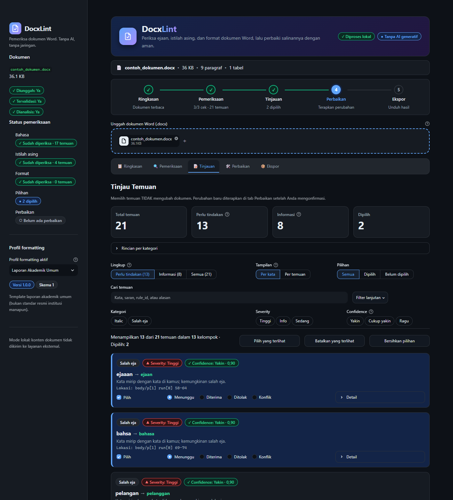
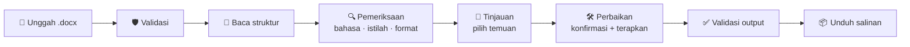
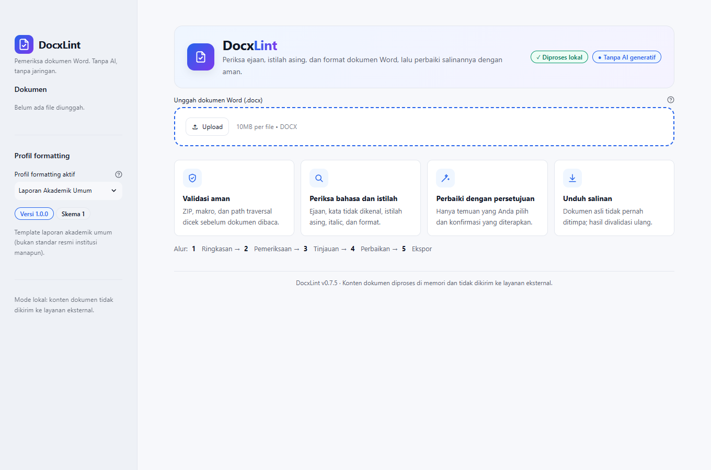
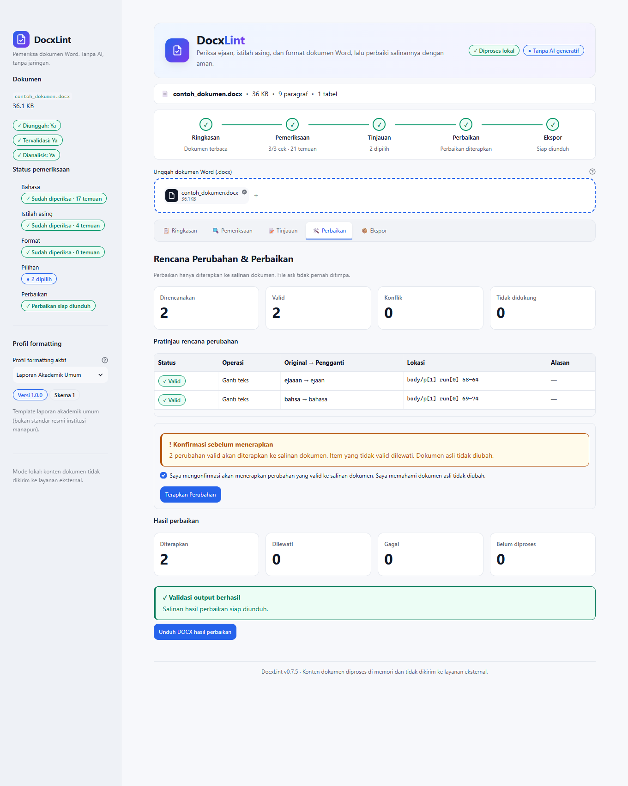

<p align="center">
  
</p>

<p align="center">
  <a href="https://docxlint-id.streamlit.app"></a>
  
  
  
  
</p>

<p align="center">
  <b><a href="https://docxlint-id.streamlit.app">🚀 Coba demo langsung</a></b> ·
  <a href="#-mulai-cepat">Mulai cepat</a> ·
  <a href="#-fitur">Fitur</a> ·
  <a href="#-privasi-dan-keamanan">Privasi</a> ·
  <a href="#-dokumentasi">Dokumentasi</a>
</p>

---

**DocxLint** memeriksa dokumen Word (`.docx`) berbahasa Indonesia: salah eja,
istilah asing yang belum di-*italic*, dan format yang tidak sesuai profil.
Setiap temuan ditinjau dulu, lalu hanya yang Anda setujui diterapkan ke
**salinan** dokumen. File asli tidak pernah ditimpa.

Semua pemrosesan berjalan di memori dengan aturan dan kamus lokal: tanpa AI
generatif, tanpa API eksternal, dan tanpa database.

<p align="center">
  
</p>

## ✨ Fitur

| | Fitur | Keterangan |
|---|---|---|
| 🛡️ | **Validasi aman** | Ukuran file, struktur ZIP, komponen wajib, makro, dan *path traversal* dicek sebelum dokumen dibaca. |
| 🔤 | **Ejaan Bahasa Indonesia** | Deteksi kemungkinan salah eja berbasis kamus lokal, dengan saran deterministik (Levenshtein, maksimal 3). "Kata tidak dikenal" dipisahkan dari typo. |
| 🌐 | **Istilah asing dan italic** | Istilah terdaftar (frasa multi-kata pun) dikenali, lalu status italic-nya diperiksa: penuh, sebagian, belum, atau tidak diketahui. |
| 📐 | **Profil format** | Font, ukuran, spasi baris/paragraf, indentasi, dan perataan dicek terhadap profil YAML: *Laporan Akademik Umum*, *Laporan Audit TI*, *Dokumen Kantor*. |
| 🧹 | **Tinjauan tanpa kebisingan** | Default hanya menampilkan temuan yang **bisa diperbaiki**; kata yang sama digabung menjadi satu kartu; ada filter, pencarian, dan paginasi. |
| 🛠️ | **Perbaikan selektif** | Rencana perubahan ditampilkan sebagai tabel, wajib dikonfirmasi, diterapkan per *run* agar format terjaga, lalu hasilnya divalidasi ulang. |
| 🌓 | **Mode terang dan gelap** | Mengikuti tema Streamlit atau setelan sistem; kontras teks ≥ 4.5:1 diuji otomatis untuk kedua mode. |

## 🧭 Cara kerja



Lima tahap di aplikasi ditampilkan sebagai tab, dengan stepper yang
menunjukkan tahap aktif:

| Tahap | Isi |
|---|---|
| 📋 **Ringkasan** | Metadata dokumen, konfigurasi aktif, pratinjau struktur. |
| 🔍 **Pemeriksaan** | Jalankan cek bahasa, istilah asing, dan format. |
| 📝 **Tinjauan** | *Perlu tindakan* / *Informasi*, tampilan *Per kata*, filter sticky, pilih massal. |
| 🛠️ **Perbaikan** | Tabel rencana perubahan, konfirmasi wajib, ringkasan hasil. |
| 📦 **Ekspor** | Unduh salinan *round-trip* atau hasil perbaikan (bila validasi lolos). |

<details>
<summary><b>📸 Tangkapan layar lainnya</b></summary>
<br>

**Halaman awal**



**Perbaikan dan validasi output**



</details>

## 🚀 Mulai cepat

**Persyaratan:** Python 3.10+ di Windows, Linux, atau macOS.

```bash
git clone https://github.com/kurniawan-Donn/docxlint-app.git
cd docxlint-app
python -m venv .venv
```

Aktifkan virtual environment:

```powershell
# Windows PowerShell
.\.venv\Scripts\Activate.ps1
```

```bash
# Linux / macOS
source .venv/bin/activate
```

Pasang dependensi lalu jalankan:

```bash
pip install -r requirements-dev.txt
streamlit run app.py
```

Aplikasi terbuka di `http://localhost:8501`.

> `requirements.txt` hanya berisi dependensi runtime (dipakai Streamlit
> Community Cloud). `requirements-dev.txt` menambahkan `pytest`.

## ⚙️ Konfigurasi

Semua aturan dan data bahasa ada di folder `config/` dan bisa diubah tanpa
menyentuh kode.

| File | Fungsi |
|---|---|
| `config/dictionary_id.txt` | Wordlist Bahasa Indonesia (satu kata per baris, kurasi manual, CC0). |
| `config/whitelist.txt` | Token yang selalu dianggap benar, misalnya `docx`, `streamlit`. |
| `config/exceptions.csv` | Pengecualian dengan alasan: kolom `word, reason`. |
| `config/terminology.csv` | Glossary istilah asing: `term, italic, category, note` (+ opsional `language, case_sensitive, priority`). |
| `config/profiles/*.yaml` | Profil format: aturan font, ukuran, spasi, indentasi, perataan beserta severity. |
| `.streamlit/config.toml` | Tema terang/gelap, batas unggah 10 MB, telemetri dimatikan. |

Kebijakan istilah asing bawaan:

- Istilah terdaftar diperiksa: `review_configured_foreign_terms = True`.
- Kandidat istilah asing yang tidak terdaftar bersifat *opt-in* dan ditandai
  belum pasti: `review_unlisted_foreign_candidates = False`.
- Italic yang sudah ada dihormati: `respect_existing_italic = True`.
- Rekomendasi italic hanya untuk istilah terdaftar; tidak ada *auto-italic*.

> **Tips:** kamus bawaan masih kecil (±270 kata), sehingga banyak kata umum
> masuk kategori *Informasi* sebagai "kata tidak dikenal". Ganti
> `dictionary_id.txt` dengan wordlist berlisensi permisif yang lebih lengkap
> untuk hasil yang jauh lebih akurat. Lihat [readme/dictionary.md](readme/dictionary.md).

## 🔒 Privasi dan keamanan

- **Lokal penuh.** `network_guard` memblokir koneksi keluar selama dokumen
  diproses. Telemetri Streamlit dimatikan (`gatherUsageStats = false`).
- **Tidak menyimpan dokumen.** File diproses di memori dan tidak ditulis ke
  disk oleh aplikasi.
- **Dokumen asli aman.** Perbaikan selalu ke salinan; bila validasi output
  gagal atau ada kegagalan kritis, unduhan diblokir dan byte asli dipakai.
- **Tampilan aman.** Teks dari dokumen di-*escape* sebelum ditampilkan;
  pesan error tidak menampilkan *traceback* maupun isi dokumen.

> ⚠️ **Demo publik** di [docxlint-id.streamlit.app](https://docxlint-id.streamlit.app)
> berjalan di server Streamlit Community Cloud. Unggah **dokumen
> non-sensitif** saja. Untuk dokumen rahasia, jalankan DocxLint secara lokal.

Detail: [readme/security_privacy.md](readme/security_privacy.md) dan
[readme/local_mode_enforcement.md](readme/local_mode_enforcement.md).

## 🧪 Pengujian

```bash
pytest -q
```

218 test mencakup validasi DOCX, pembaca dan *round-trip*, network guard,
tokenizer, kamus, glossary, pemeriksa bahasa dan istilah asing, inspeksi
italic, review state, repair engine, validasi output, serta helper UI
(kontras warna kedua tema, stepper, pengelompokan, paginasi, dan *escaping*
HTML).

## ☁️ Deploy ke Streamlit Community Cloud

1. *Fork* atau push repo ini ke GitHub Anda.
2. Buka [share.streamlit.io](https://share.streamlit.io), masuk dengan GitHub,
   pilih **Create app → Deploy a public app from GitHub**.
3. Isi repository, branch `main`, dan main file `app.py`. Python 3.12–3.14
   didukung.
4. Di **Advanced settings → Secrets**, tambahkan:
   ```toml
   DOCXLINT_PUBLIC_DEMO = "1"
   ```
   agar aplikasi menampilkan badge dan peringatan demo publik.
5. Klik **Deploy**. Setiap push ke `main` akan ter-deploy ulang otomatis.

## 🗂️ Struktur proyek

```text
docxlint-app/
├── app.py                      # orchestrator tipis: tema → upload → tab stage
├── config/                     # kamus, whitelist, glossary, profil format
├── src/docxlint/
│   ├── models/                 # Finding, Location, ChangePlan, Profile
│   ├── services/               # validator, reader, checker, repair engine
│   ├── ui/
│   │   ├── theme.py            # design tokens terang/gelap + CSS
│   │   ├── components.py       # komponen murni + render_*
│   │   ├── review_view.py      # lingkup, grup, urutan, paginasi
│   │   └── sections/           # satu modul per tahap
│   └── utils/
├── tests/                      # pytest
├── readme/                     # dokumentasi desain dan keputusan
└── .streamlit/config.toml
```

## 📚 Dokumentasi

| Topik | Dokumen |
|---|---|
| Kebutuhan dan arsitektur | [requirements.md](readme/requirements.md) · [architecture.md](readme/architecture.md) · [data_model.md](readme/data_model.md) |
| Aturan dan konfigurasi | [rule_engine.md](readme/rule_engine.md) · [config_schema.md](readme/config_schema.md) · [editorial_rules.md](readme/editorial_rules.md) · [glossary.md](readme/glossary.md) · [dictionary.md](readme/dictionary.md) |
| Dokumen Word | [format_preservation.md](readme/format_preservation.md) · [location_mapping.md](readme/location_mapping.md) · [supported_features.md](readme/supported_features.md) |
| Keamanan dan validasi | [security_privacy.md](readme/security_privacy.md) · [local_mode_enforcement.md](readme/local_mode_enforcement.md) · [runtime_validation.md](readme/runtime_validation.md) |
| UI | [ui_design.md](readme/ui_design.md) · [ui_metrics.md](readme/ui_metrics.md) |
| Proses | [testing_strategy.md](readme/testing_strategy.md) · [traceability_matrix.md](readme/traceability_matrix.md) · [decisions_log.md](readme/decisions_log.md) · [risks_and_tradeoffs.md](readme/risks_and_tradeoffs.md) · [implementation_roadmap.md](readme/implementation_roadmap.md) |

## ⚠️ Batasan

- Kamus bawaan kecil, sehingga cakupan ejaan terbatas (lihat tips di atas).
- *Run* kompleks (field, hyperlink, dan sejenisnya) dilewati, bukan diforsir.
- *Style inheritance* yang tidak dapat diresolusi dilaporkan sebagai
  `unknown`.
- Temuan format baru ditampilkan; belum masuk alur Tinjauan dan Perbaikan.
- Perbaikan otomatis mendukung penggantian teks ejaan dan penerapan italic.

<details>
<summary><b>🛤️ Riwayat pengembangan</b></summary>
<br>

| Fase | Fokus |
|---|---|
| Phase 2 | Fondasi: validasi DOCX, pembaca struktur, ekspor *round-trip*, network guard. |
| Phase 3 | Pemeriksa bahasa lokal: ejaan, kata tidak dikenal, saran deterministik. |
| Phase 4 | Istilah asing terdaftar dan inspeksi italic. |
| Phase 5 | Alur tinjauan: pilih, filter, cari, status. |
| Phase 6 | Repair engine selektif dengan validasi output dan rollback. |
| Phase 7 | Profil format, formatting checker, invalidasi berbasis konfigurasi. |
| Phase 7.5 | UI modern: tab tahap, stepper, mode gelap, tinjauan ringkas, deploy ke Streamlit Cloud. |

</details>

---

<p align="center">
  Dibuat oleh <a href="https://github.com/kurniawan-Donn">kurniawan-Donn</a> ·
  Kamus bawaan dirilis CC0 · Lisensi kode belum ditentukan
</p>
